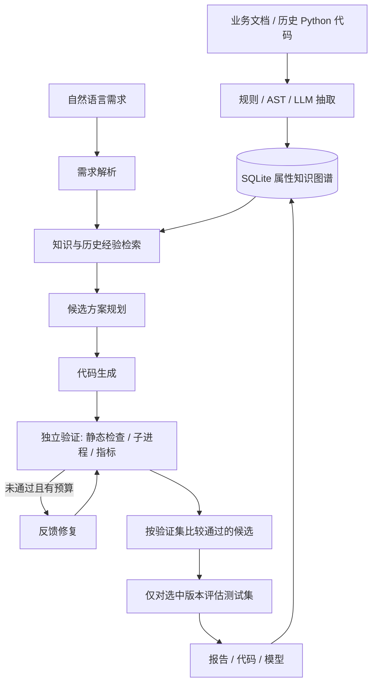

# Capability Forge · 基于 AI Agent 的算法能力工厂

一个用于 LLM Agent 笔试/申博测试的可复现原型：从客户流失预测的自然语言需求出发，检索业务知识，规划候选算法，生成代码，独立验证，按反馈修复，并将能力版本和验证经验回写到知识库。

**状态：离线 mock 闭环经过实际运行。真实 GLM-4.7-Flash 已完成连接测试及知识抽取（接受 12 条事实）；完整算法流程因服务拥堵 1305 暂未完成。Ollama/OpenAI 仅完成接口契约测试。数据全部为模拟数据。**

## 1. 背景和目标

业务算法知识通常散落在需求文档、历史代码与实验报告中。本项目验证这些知识能否形成可追溯的生成依据，并通过独立验证器把生成结果转成经过检查的算法能力。业务场景为客户流失二分类，算法产出是客户流失概率；系统产出是代码、模型、验证报告、修复轨迹与更新后的知识图谱。

## 2. 架构与模块



| 模块 | 文件 | 职责 |
|---|---|---|
| 数据 | forge/data.py | 固定种子模拟数据，分层训练/验证/测试划分 |
| 知识 | forge/knowledge.py | 文档/AST/LLM 抽取、来源核对、检索、图谱、版本记录 |
| LLM | forge/llm.py | 显式 mock、Ollama、OpenAI 与智谱 GLM 后端 |
| 工作流 | forge/workflow.py | 角色交接、候选比较、修复预算、回写 |
| 验证 | forge/validation.py、worker.py | 宿主指标计算和子进程接口检查 |
| 静态检查 | forge/safety.py | AST 防误操作检查 |
| 报告 | forge/reporting.py | Markdown/JSON 报告、离线 HTML 图谱 |
| 入口 | forge/cli.py | init、ingest、run、graph、inspect |

选择理由与接口说明见 [architecture.md](docs/architecture.md)。角色串行执行，共享 LLM 后端；没有实现自主并行多智能体。

## 3. 环境配置

推荐 Python 3.11–3.14。实际验证环境与精确依赖见 [requirements-lock.txt](requirements-lock.txt)，该锁定文件记录 Windows/Python 3.14 的实测环境；其他 Python 版本优先安装兼容范围依赖。

在仓库根目录执行：

```powershell
python -m venv .venv
.\.venv\Scripts\Activate.ps1
python -m pip install -r requirements-dev.txt
python -m pip install -e .
```

如果 PowerShell 不允许激活，可直接使用 `.\.venv\Scripts\python.exe` 替代下面命令中的 `python`。Linux/macOS 激活方式为 `source .venv/bin/activate`。正常离线运行不需要密钥或联网；首次安装依赖需要网络。

## 4. 运行完整示例

```powershell
# 初始化：已有 data/churn.csv 时保留，不覆盖
python -m forge init

# 正常生成：比较两个候选，选择后评估测试集
python -m forge run --task-file examples/task.txt

# 故障注入：初版逻辑回归不能处理未知类别，验证后触发修复
python -m forge run --task-file examples/task.txt --inject-fault

# 再次运行：从同一数据库检索刚才的失败经验
python -m forge run --task-file examples/task.txt

# 也可以直接输入自然语言
python -m forge run --description "客户流失预测，处理缺失值和未知类别，比较两个算法"

# 导出最新图谱；用浏览器打开生成的 HTML
python -m forge graph
```

终端输出报告路径。每次运行目录包含：

```text
report.json / report.md       # 汇总、指标、检查、修复记录
events.json                  # 角色输入输出和检索上下文
forest/attempt_0/algorithm.py # 候选实现
logistic/attempt_*/           # 每轮代码、输入、原始结果与日志
selected/algorithm.py         # 最终选中代码
selected/model.joblib         # 经保存加载检查的模型
knowledge_graph.json / .html # 本次回写后的快照
```

正常退出码为 0，运行未通过为 1，配置或输入错误为 2。数据库和默认运行目录位于 Git 忽略的 runtime/。使用 `python -m forge --db path/to/other.sqlite ...` 可创建独立实验知识库；全局参数必须放在子命令前。

## 5. 真实 LLM 模式

### 智谱 GLM-4.7-Flash（当前选择）

先按 [智谱接入指南](docs/glm-setup.md) 在自己的智谱账号创建 API Key，确认免费模型可调用。Windows 双击 `check-glm.cmd` 隐藏输入密钥，连接成功后双击 `run-glm.cmd`。不会切换到其他收费模型。

```powershell
python scripts/run_glm.py
python scripts/run_glm.py --run
```

使用 ZHIPU_API_KEY，模型固定 glm-4.7-flash，结果在 runtime/glm/。已有真实连接与知识抽取证据见 [GLM 进展](examples/glm/PROGRESS.md)，尚未证明真实模型成功生成并通过算法验证。再次运行会复用材料未变的已核对知识及成功模型响应；验证与指标仍重新计算。

### OpenAI API（使用 ChatGPT 网页账号的同学先看这里）

账号准备、API 额度、密钥隐藏输入及故障排查见 [OpenAI 接入指南](docs/openai-setup.md)。按第 3 节安装后，在个人终端运行：

```powershell
python scripts/run_openai.py        # 隐藏输入密钥，发一次连接检查请求
python scripts/run_openai.py --run  # 独立知识库，执行真实模型闭环
```

程序从当前进程环境读取 OPENAI_API_KEY，不保存密钥。默认 gpt-4.1-mini，可用 --model 替换。尚无真实账户调用实测结果；配置检查和模拟响应测试不能作为真实模型成功证据。

### 本地 Ollama

先在自己的环境部署 Ollama 并准备具有代码生成能力的模型。将下面 `YOUR_INSTALLED_MODEL` 替换为 `ollama list` 中实际可用的模型名：

```powershell
# 对文档额外执行 LLM 知识抽取；引用编号原文片段，由宿主附上可核对引文
python -m forge ingest materials --provider ollama --model YOUR_INSTALLED_MODEL

# 真实模型参与需求理解、规划、代码生成和修复
python -m forge run --task-file examples/task.txt --provider ollama --model YOUR_INSTALLED_MODEL
```

可通过 `--base-url http://localhost:11434` 指定服务器。实现参考 [Ollama chat 官方接口](https://docs.ollama.com/api/chat)。服务器不可用、模型不存在或返回不合规时会明确失败，不会悄悄改用 mock。

本项目没有下载模型，也没有验证任何具体模型的通过率。真实模型实验应单独保存报告，并检查 mode=ollama。Mock 的理解/规划是规则，生成是模板，修复是重新生成安全模板；**mock 结果只能证明工程闭环可运行，不能证明真实 LLM 的算法开发能力**。

## 6. 数据、知识 schema 与抽取结果

- `data/churn.csv`：1200 行模拟数据，3 个数值特征、2 个类别特征、二分类标签，含约 3.5% 的特征缺失值。标签由概率机制采样，非可完全拟合的确定规则。
- `materials/churn_business.md`：模拟业务规则、处理策略、指标与环境说明。
- `materials/historical_code.py`：用于 AST 抽取的历史函数示例。
- [schema.md](docs/schema.md)：节点、关系、版本策略及边界。
- `examples/knowledge_graph.json`：实际运行后导出的知识抽取与回写结果。

SQLite 用 nodes/edges 表表达属性图，Capability 保存输入输出及适用条件，AlgorithmVersion 保存代码摘要，ValidationRun 关联报告，FailureCase 保存错误与故障注入标记，Source 支持来源追溯。检索为中文双字词/英文词重叠，尚未实现图搜索或向量检索。

## 7. Agent 工作流与生成代码

工作流使用 understand → retrieve → plan → generate → validate → repair → final_evaluation → persist 的显式交接。每个阶段保留结构化产物，修复上限默认两轮，代码版本与错误记录均不覆盖。

生成模块接口示例：

```python
def build_model(seed=42):
    # 实际生成文件中包含 ColumnTransformer、Imputer、Encoder 与模型
    return Pipeline([("preprocessing", preprocessing), ("classifier", classifier)])

def predict(model, frame):
    missing = set(FEATURES) - set(frame.columns)
    if missing:
        raise ValueError(f"Missing columns: {sorted(missing)}")
    return model.predict_proba(frame[FEATURES])[:, 1]
```

完整可运行生成代码见 `examples/runs/*/selected/algorithm.py`；本段仅解释接口。

预测新客户：将 `RUN_DIR` 替换为终端返回的运行目录。

```powershell
python scripts/predict.py --artifact RUN_DIR/selected --input examples/predict_input.csv --output runtime/predictions.csv
```

## 8. 自动验证与结果

```powershell
python -m pytest -q
python scripts/validate.py --code RUN_DIR/selected/algorithm.py
python -m forge inspect RUN_DIR/report.json
```

固定分层划分 60%/20%/20%。验证集用于候选选择和修复，保留测试集只评估选中代码。预处理在训练 Pipeline 内拟合；子进程只接收评估特征，宿主保留评估标签并计算指标。遵循 [scikit-learn 的数据泄漏防范原则](https://scikit-learn.org/stable/common_pitfalls.html)。

检查包括概率向量形状/范围、字段缺失、未知类别、全缺失输入、列顺序、重复预测、保存重载、指标门槛和执行超时。默认指标门槛 ROC-AUC ≥ 0.65、F1 ≥ 0.45，仅为模拟任务演示标准，可修改 configs/churn.json。自然语言要求不自动覆盖独立验收策略。

实测正常运行选中逻辑回归，测试 ROC-AUC **0.7829**，F1 **0.6432**。完整三次示例、各候选验证指标与报告链接见 [RESULTS.md](examples/RESULTS.md)。这些指标来自模拟数据和 mock 模板代码，不代表真实业务或真实模型效果。

## 9. 挑战与解决方案

| 问题 | 处理方式 |
|---|---|
| LLM 输出不确定或无法部署 | 固定接口、受控候选、显式 mock；真实适配器单独配置 |
| 生成代码自报成功不可信 | 独立宿主验证器计算指标，按统一规则判定 |
| 数据泄漏与反复看测试集 | 先划分数据，训练集拟合，只按验证集修复/选择 |
| 失败难复现 | 保存代码、反馈、环境、数据摘要、seed 和角色轨迹 |
| 知识缺乏依据 | 文档来源、代码位置、内容摘要、原文引证核对 |
| 经验沉淀只是存日志 | FailureCase 单独建节点，并进入后续规划及生成上下文 |
| 生成代码执行风险 | AST 检查、独立子进程、超时和线程限制；不声称是安全沙箱 |

## 10. 限制与扩展

当前只支持固定字段的客户流失二分类。没有 Web 服务、MCTS、跨场景迁移或真实 LLM 效果对照实验；不将这些列为已实现功能。

可通过 forge/plugins/*.json 扩展受信任算法模板，通过 validation.METRICS 扩展指标。新任务需要同时扩展字段 schema、模板和验证器，不能仅改 prompt。失败建议目前是规则，不是模型自动根因分析。

执行子进程不是操作系统级沙箱；AST 检查不保证恶意代码安全。正式服务需要容器/VM、网络和文件系统隔离、资源/输出上限。仅加载可信 joblib。资源报告的 python_peak_mb 只统计 Python 分配，非进程总内存。

后续研究可比较直接生成、文档知识增强、历史失败经验增强，在相同模型与预算下测量首次通过率、修复次数、调用成本和最终表现。当前经验复用示例只证明信息进入工作流，没有证明统计显著的质量提升。

五分钟演示流程及常见追问见 [demo.md](docs/demo.md)。本地 Git 仓库有分阶段提交；推送自己的 GitHub 仓库时使用：

```powershell
git remote add origin YOUR_GITHUB_REPOSITORY_URL
git push -u origin main
```

提交包不含 LLM 模型、密钥或虚拟环境。仓库未指定许可证，提交和公开发布前由作者决定许可方式。
