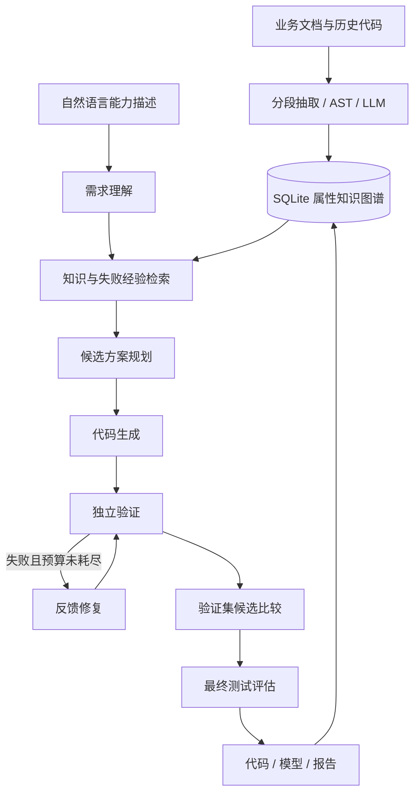

# 算法能力工厂技术报告

## 1. 问题定义

本项目的输入是自然语言算法能力描述，以及可供复用的业务文档和历史代码；输出是算法源码、模型产物、验证报告和能力知识记录。我把系统划分为两个相互连接的过程：一是从材料中抽取能力知识，二是利用知识生成、验证和沉淀算法。

主任务为客户流失预测，迁移任务为客服工单紧急程度分类。两者都是二分类，但输入分别为结构化表格和文本，适合检验工作流能否复用。

## 2. 技术选择与架构

我采用 Python 实现显式工作流，用 SQLite 保存属性图和运行记录，用 scikit-learn Pipeline 组织预处理与分类器。真实模型后端采用 GLM-4.7-Flash，离线后端使用显式规则和模板。入口采用 CLI，以降低环境部署成本。



状态机让我能够显式控制每个环节的输入输出、重试和修复预算，并在失败时保留已经完成的工作。角色共享模型适配器、按顺序执行；这是多角色工作流，当前没有加入多个自治智能体的协商机制。

## 3. 知识抽取与图谱

我设计了 Capability、Source、Knowledge、Function、Requirement、Strategy、AlgorithmVersion、ValidationRun、Metric、Environment 和 FailureCase 等节点。关系包括 SUPPORTED_BY、ADDRESSED_BY、IMPLEMENTED_BY、VALIDATED_IN 和 REUSED_EXPERIENCE。

Markdown 按二级标题切分，Python 文件通过 AST 提取顶层函数、注释和导入依赖。LLM 抽取时，我先为材料片段编号，再要求模型引用 `source_chunk_id`。宿主依据编号补入原文与行号，并拒绝未知编号和冲突引文。这样能够核对来源，但知识是否完整、语义是否充分仍需要后续评价。

检索结合显式条件与文本重叠：根据训练画像和需求约束，从 Requirement 经 Strategy 到达支持的 Knowledge/Function，再对结果排序。每条返回记录保留路径。历史失败经验按任务过滤，进入规划和修复上下文。

图谱以 SQLite 节点表和边表实现，同时保存运行及抽取审计表；可导出 JSON 和离线 SVG/HTML 视图。算法版本以运行、候选、尝试编号及源码 SHA256 追溯。

## 4. Agent 工作流

需求理解阶段输出任务、目标、指标与约束，宿主检查任务是否受支持。数据画像只基于训练集计算，包括缺失率、类别比例、字段类型或文本长度。

规划阶段输出候选算法、参数、预处理、设计理由与证据 ID。参数必须位于注册的有界空间，引用必须来自本次检索结果。代码生成阶段提供接口契约、当前候选估计器与参数，要求实现两个顶层函数：

```python
def build_model(seed=42):
    # 返回未拟合的 sklearn Pipeline
    ...

def predict(model, frame):
    # 返回与输入行顺序一致的一维正类概率
    ...
```

宿主执行验证后，将旧代码、结构化失败信息和规则式修复建议交给下一轮。默认每个候选首次生成一次，最多修复两轮。输出格式错误和代码错误消耗既定预算；认证、服务和网络错误分别处理。通过校验的模型响应可以缓存，但算法验证仍重新执行。

## 5. 验证设计

数据以固定随机种子分层划分为 60% 训练集、20% 验证集和 20% 测试集。子进程获得训练数据和待预测特征，评估标签保留在宿主，由宿主独立计算 ROC-AUC、F1、accuracy 等指标。

验证包含四个层面：

| 层面 | 检查内容 |
|---|---|
| 功能与计划一致性 | 代码可执行、分类器类型、参数、预处理及随机种子 |
| 接口契约 | 必要字段、概率长度、范围、顺序和有限值 |
| 稳定性 | 缺失输入、未知类别/未见词表、重复预测、保存重载 |
| 指标与资源 | 配置门槛、运行超时、worker/wall 时间和 Python 分配峰值 |

验证通过的候选按配置指标选择，再对选中版本执行最终测试。客户流失按验证 ROC-AUC 选择；文本按验证 F1 选择。文本案例两候选的验证 F1 相同，程序保留顺序靠前的逻辑回归。

AST 导入检查、独立子进程、环境变量过滤、超时和线程限制用于减少误操作。当前没有操作系统级的文件、网络和进程隔离，部署到不可信环境仍需容器或虚拟机。

## 6. 案例与结果

### 客户流失预测

真实 GLM 案例接收缺失值、未知类别和不平衡约束，生成候选计划与算法代码。宿主对逻辑回归编码器显式注入未知类别缺陷，验证器检测后返回反馈，模型完成修复。

最终选择逻辑回归，测试 ROC-AUC=0.7829，F1=0.6432，accuracy=0.7042，12 项检查通过。随机森林原运行出现动态模块序列化问题；修正宿主加载器后，同一份源码通过验证集复核。原始报告与复核结果分别保留。

### 工单文本分类

文本任务采用字符级 TF-IDF，比较逻辑回归与多项式朴素贝叶斯。真实 GLM 的自主尝试出现输出格式、分类器选择和 DataFrame 输入处理错误。

开发过程中，我借助编码助手对已有代码增加 DataFrame 到 `text` 列的接口处理，并保留逐行补丁。两个候选随后通过验证，验证 ROC-AUC 分别为 0.8455 和 0.8369，验证 F1 均为 0.8221。最终选择逻辑回归，测试 ROC-AUC=0.8701，F1=0.8765，balanced_accuracy=0.8750，12 项检查通过。

该结果记录为 `assisted_glm`：它复用了真实模型源码，并包含开发阶段的外部接口补丁。复现不产生新的 API 调用。原自主尝试的失败记录保留，补丁没有修改估计器、参数或指标门槛。

### 测试与复现

项目归档了 96 项 pytest 通过记录，覆盖模型适配、抽取、契约校验、缓存恢复、工作流、任务插件和验证逻辑。文本半自动案例已从提交包解压后的代码与材料成功复现。

两类数据均为固定种子生成的模拟业务数据。这些结果用于验证工程流程，不用于估计真实行业泛化效果。当前三组对照仅完成离线流程检查，没有真实模型的知识增强效果结论。

## 7. 开发中的问题与处理

| 问题 | 我的处理 |
|---|---|
| 模型返回结构不稳定 | 增加输出 schema、原始响应审计、有限纠正及单层包装解包 |
| 服务拥堵和网络中断 | 区分业务码、网络与认证错误，设置有限退避重试及阶段缓存 |
| 动态模块无法重载 | 在加载器中注册模块，复核原始代码，保留原失败记录 |
| 文本清洗器误用 DataFrame | 明确宿主调用形状，提供当前候选契约及针对性修复建议 |
| 失败日志难以复用 | 将可归类的失败保存为 FailureCase，并按任务检索 |
| 生成结果与计划不一致 | 由宿主检查分类器、超参数与预处理，不接受模型自报成功 |

## 8. 可扩展性与研究计划

任务、算法与指标具有注册接口。兼容算法可增加元数据或安装入口；新任务需实现读取、画像、接口及验证契约。当前指标选择采用高者更优，损失型指标需要进一步扩展排序方向。

后续我将建立固定任务集，在相同模型和预算下比较 direct、knowledge、knowledge_repair 三组，统计首次通过率、最终通过率、修复次数、tokens、耗时和最终性能。进一步的工作包括真实数据验证、完整代码隔离、仓库级能力抽取，以及面向算法方案的搜索策略。

代码、测试及结果入口见 [项目材料索引](../提交说明.md)。
